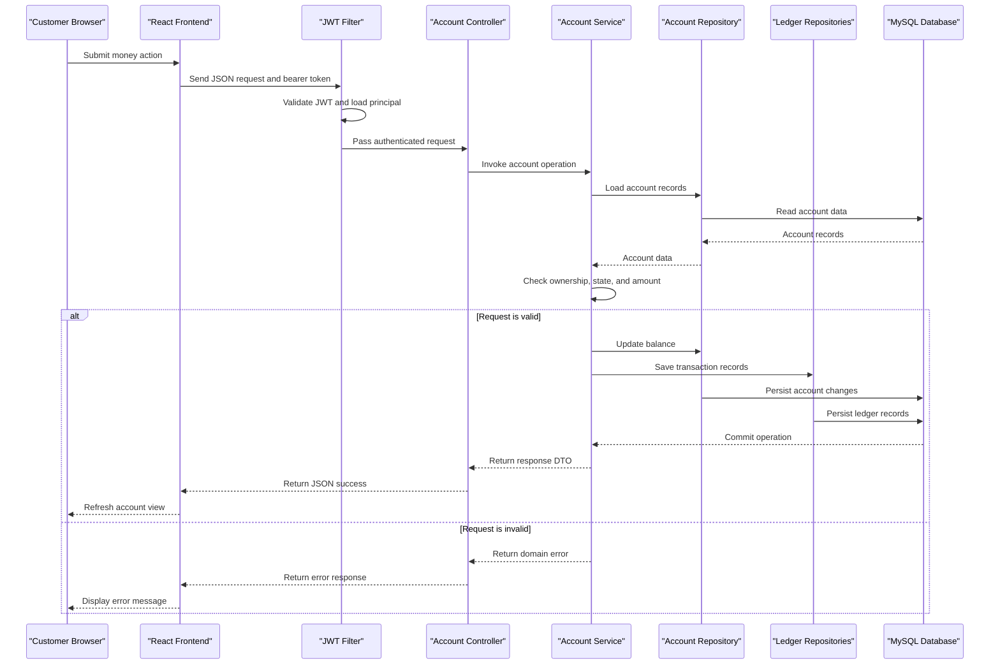

# API & Service Communication Contracts

BankEase exposes a synchronous JSON REST API through one Spring Boot backend. The API includes user, authentication, account, transaction-history, and money-movement operations; the React application calls it directly.

## Service Catalog

| Service | Port | Category | Purpose |
|---|---:|---|---|
| BankEase backend | 8080 by default | API Layer and Business | Authenticates users and manages customer, account, and money-movement operations |
| BankEase frontend | 5173 in Vite development | Client | Browser UI for registration, sign-in, dashboard, accounts, and money actions |
| MySQL | 3306 in local configuration | Infrastructure | Relational persistence for application data |

The repository contains one backend application; the frontend and database are separately running dependencies, not backend microservices.

## API Endpoints Inventory

| Service / Controller | Method | Path | Request Type | Response Type |
|---|---|---|---|---|
| UserController | POST | `/api/users` | JSON `User` | `UserResponse` |
| AuthController | POST | `/api/auth/login` | JSON `LoginRequest` | `LoginResponse` |
| UserController | GET | `/api/users/{id}` | Path `id` | `UserResponse` |
| UserController | GET | `/api/users` | None | List of `UserResponse` |
| UserController | PATCH | `/api/users/{id}` | Path `id`, JSON `UpdateUserRequest` | `User` |
| UserController | DELETE | `/api/users{id}` | Path `id`; controller annotation has no slash before `{id}` | Empty response |
| AccountController | POST | `/api/accounts` | JSON `CreateAccountRequest` | `AccountResponse` |
| AccountController | GET | `/api/accounts` | Authenticated principal | List of `AccountResponse` |
| AccountController | GET | `/api/accounts/{id}` | Path `id`, authenticated principal | `AccountResponse` |
| AccountController | DELETE | `/api/accounts/{id}` | Path `id`, authenticated principal | Success message |
| AccountController | POST | `/api/accounts/{id}/deposit` | Path `id`, JSON `DepositRequest` | `AccountResponse` |
| AccountController | POST | `/api/accounts/{id}/withdraw` | Path `id`, JSON `WithdrawRequest` | `AccountResponse` |
| AccountController | GET | `/api/accounts/{id}/transactions` | Path `id`, authenticated principal | List of `TransactionResponse` |
| AccountController | POST | `/api/accounts/transfer` | JSON `TransferRequest`, authenticated principal | `TransferResponse` |

API versioning is not configured in the inspected source. The controller does not explicitly set success status codes for most methods, so framework defaults apply.

## Management & Observability Endpoints

No Spring Boot Actuator dependency, health endpoint, custom metrics, or observability endpoint was found in the inspected project dependencies/source.

## DTOs & Contracts

| Contract type | DTO / model | API role |
|---|---|---|
| Request | `LoginRequest` | Credentials submitted to login |
| Response | `LoginResponse` | Token and basic user details returned from login |
| Request | `CreateAccountRequest` | Requested account type |
| Request | `DepositRequest`, `WithdrawRequest` | Amount for money operations |
| Request | `TransferRequest` | Sender account ID, receiver account ID, and amount |
| Request | `UpdateUserRequest` | Optional profile changes |
| Response | `UserResponse` | Public user profile response |
| Response | `AccountResponse` | Account summary response |
| Response | `TransactionResponse` | Ledger transaction response |
| Response | `TransferResponse` | Transfer response |
| Error response | `ApiErrorResponse` | Status, error name, and message |
| Domain request body | `User` | Registration request currently binds directly to the entity |

The DTOs are mutable Java classes with getters/setters; Java records or immutable DTOs were not found. No OpenAPI/Swagger, GraphQL schema, or protobuf definition was found. JSON serialization is provided by Spring Boot's Jackson integration.

The profile PATCH endpoint returns the `User` entity rather than `UserResponse`. The entity has a password getter, so the serialized response should be reviewed to ensure a password hash is not returned.

## Communication Patterns

- **Synchronous:** browser-to-backend HTTP JSON over Axios; backend controller-to-service and service-to-repository calls are in-process synchronous calls.
- **Asynchronous:** no message broker or asynchronous business event path was found.
- **Gateway/aggregation:** no API gateway or multi-service response aggregation was found.
- **Resilience:** no retry, timeout, circuit-breaker, or bulkhead configuration was found.
- **Discovery/load balancing:** frontend uses a configured local API base URL; no service discovery or client-side load balancing was found.
- **Persistence:** one backend writes to and reads from MySQL through Spring Data JPA/Hibernate.
- **Authentication:** Spring Security stateless authentication with JWT; passwords are BCrypt encoded. Registration and login are permitted without authentication; other API routes require an authenticated request.
- **Authorization:** account service operations include ownership checks, and transfer validates sender ownership. No role-based permissions are configured. User-management routes do not show user-specific ownership checks.
- **Transport security:** local frontend API URL uses HTTP. TLS termination is not configured in the inspected application files.
- **Cross-origin:** backend allows the local Vite origin `http://localhost:5173`; a different frontend origin will not automatically be allowed.

For detailed business rules and ownership boundaries, see `business-workflows.md` and `data-architecture.md`.

## Service Technology Matrix

| Service | Web | Data Access | Discovery | Gateway | Actuator | Cache | Metrics |
|---|---|---|---|---|---|---|---|
| BankEase backend | Spring MVC | Spring Data JPA / Hibernate | None | None | Not found | Not found | Not found |
| BankEase frontend | React / Vite | Axios API client | Not applicable | Not applicable | Not applicable | Not found | Not found |

## Service Communication Sequence

<!-- mermaid-checked: every participant uses `participant Id as "Label"`, no \n in aliases/messages/notes, every alt/opt/loop closed by end, no `:` inside any alias -->

