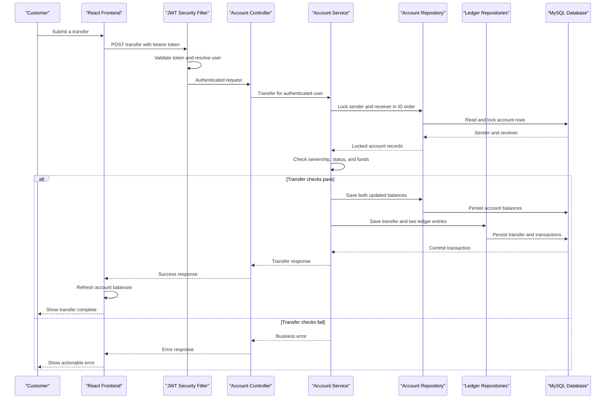

# Core Business Workflows

BankEase lets customers create a profile, open and manage bank-account records, and move balances through deposit, withdrawal, and transfer operations. The core financial actions update account balances and create transaction records in the same backend workflow.

## Domain Entities

| Entity | Service / Bounded Context | Description | Key Relationships |
|---|---|---|---|
| User | BankEase / Customer access | Customer identity and sign-in profile | Owns one or more accounts |
| Account | BankEase / Account management | Savings/current account with lifecycle status and balance | Owned by a user; associated with transactions; may be sender or receiver in transfers |
| Transaction | BankEase / Account ledger | A dated deposit, withdrawal, or transfer-side ledger entry | Belongs to an account; transfer link is optional |
| Transfer | BankEase / Money movement | Records an account-to-account movement | References sender and receiver accounts; represented by outgoing and incoming transaction entries |

## Service-to-Domain Mapping

| Service | Domain Context | Owned Entities | External Dependencies |
|---|---|---|---|
| BankEase backend | Customer access, account management, money movement | User, Account, Transaction, Transfer | MySQL database; browser frontend calls its REST API |

The repository is a single Spring Boot application. There are no separate domain services, message brokers, or cross-service data exchange flows in the scanned code.

## Primary Workflows

### Workflow 1: Register and sign in

1. Visitor submits profile fields from the registration screen.
2. Frontend confirms the password and sends the registration request.
3. Backend validates the user fields, rejects a duplicate email, BCrypt-hashes the password, and saves the user.
4. Registration returns a user response; it does not issue a session token.
5. Customer submits credentials through the login screen.
6. Backend looks up the user, compares the submitted password with the stored hash, and creates a signed JWT.
7. Frontend stores the bearer token in session storage and opens the dashboard.

Rules involved: email uniqueness, valid profile inputs, password length constraints, BCrypt hashing, and login credential match.

### Workflow 2: Open and view accounts

1. Authenticated customer chooses savings or current.
2. Backend creates an active account for the authenticated user, generates a unique account number, and initializes a zero balance.
3. Frontend reloads the user's accounts and calculates the aggregate balance of active accounts.

Rules involved: account type must be supported; account number must be unique; initial balance is zero.

### Workflow 3: Deposit or withdraw

1. Customer selects an active account and enters an amount.
2. Backend resolves the account within the authenticated user's ownership boundary and rejects closed accounts.
3. Deposit adds the amount; withdrawal checks sufficient balance before subtraction.
4. Backend saves the updated account and a ledger transaction with the balance after the operation.
5. Frontend reloads account summaries and displays the operation result.

Rules involved: amount must be positive with up to two decimal places; closed accounts cannot transact; withdrawal cannot exceed available balance.

### Workflow 4: Transfer between accounts

1. Customer selects the sender account and enters a distinct recipient account ID and amount.
2. Backend locks sender and receiver rows in ascending ID order.
3. It verifies sender ownership, both accounts are open, and sender funds are sufficient.
4. In one database transaction, it subtracts from sender, adds to receiver, saves the transfer record, and creates `TRANSFER_OUT` and `TRANSFER_IN` transaction records.
5. Frontend reloads the signed-in user's account balances.

Rules involved: sender and receiver must differ; sender must belong to the signed-in user; both accounts must be open; transfer amount must not exceed sender balance. The current backend accepts receiver account ID rather than public account number.

### Workflow 5: Close account and retrieve ledger

These are API workflows but are not yet exposed as dashboard screens. An owned account may be marked closed only when its balance is zero. An authenticated customer may retrieve an owned account's transaction history ordered newest first.

## Cross-Service Data Flows

No cross-service composition or aggregation was found. The React frontend makes direct synchronous HTTP requests to a single Spring Boot API. The API uses a single MySQL persistence boundary; no queue, event bus, remote service, retry policy, or circuit-breaker fallback is present in the repository.

## Business Workflow Sequence

<!-- mermaid-checked: every participant uses `participant Id as "Label"`, no \n in aliases/messages/notes, every alt/opt/loop closed by end, no `:` inside any alias -->

## Business Rules & Decision Logic

### Validation and decisions

- Registration requires a valid email, unique email, name, phone, date of birth, and password; password confirmation is checked by the frontend.
- Login rejects unknown email or mismatched password with a generic invalid-credentials message.
- Account type is `SAVINGS` or `CURRENT`; account status is `ACTIVE` or `CLOSED`.
- Deposit, withdrawal, and transfer require a positive decimal amount with no more than two fraction digits.
- Closed accounts cannot be used for deposit, withdrawal, or transfer.
- Withdrawals and transfers fail if sender balance is insufficient.
- Transfer must not target the same account as its sender.
- Account closure is blocked when balance is non-zero.
- User deletion is blocked when the user has accounts.

### State, transaction, and audit behavior

- New account: `ACTIVE`, zero balance.
- Account closure: `ACTIVE` to `CLOSED`; account record remains persisted.
- Deposit, withdrawal, and transfer operations are annotated transactional in the service.
- Transfers lock account rows in ascending account-ID order and write one transfer plus paired transaction records.
- Transaction records include the post-operation balance; they are used for account history.
- No separate audit-event subsystem, outbox, compensating workflow, or external settlement log was found.

### Authorization boundaries

- Registration and login are public; remaining routes require an authenticated JWT.
- Account-scoped operations generally resolve account records by authenticated user ID.
- Transfer verifies sender ownership. The recipient may be a different user's account.
- No role-based access model was found. The user-management controller does not show record ownership enforcement on get/list/update/delete methods.

> Note: Some workflows or business rules may not be represented in the current source tree.
