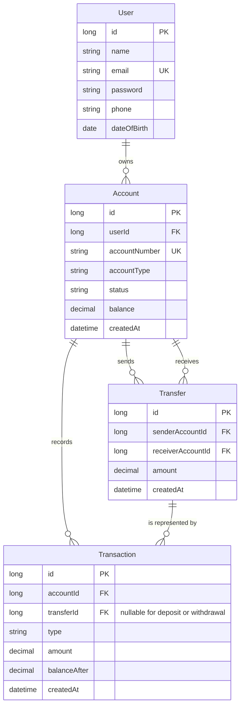

# Data Architecture & Persistence Layer

BankEase persists four primary JPA entities in a MySQL relational database. Spring Data JPA with Hibernate provides the ORM and repository access; no cache or schema migration framework was found.

## Database Configuration

| Service/Module | DB Type | Profile | Driver | Connection | Migration Tool |
|---|---|---|---|---|---|
| BankEase backend | MySQL | Default/local configuration | MySQL Connector/J | Local MySQL database `bankease`; credentials are configured separately and omitted here | None found; Hibernate manages schema updates |

Hibernate schema auto-update and SQL statement logging are enabled in the checked-in application properties. No profile-specific database setup, SQL seed scripts, Flyway, or Liquibase files were found.

## Data Ownership per Service

| Service | Tables Owned | ORM Framework | Caching | Notes |
|---|---|---|---|---|
| BankEase application | User, Account, Transaction, Transfer | Spring Data JPA / Hibernate | None found | Single backend service owns and accesses all application entities |

## Entity Model

`User` owns a collection of `Account` records. Each account owns its transaction history. A transfer references a sender account and a receiver account; transfer-generated ledger entries link back to the transfer. Deposits and withdrawals have no transfer link.

Source entities: `src/main/java/com/bankease/entity/User.java`, `Account.java`, `Transaction.java`, and `Transfer.java`. `AccountStatus`, `AccountType`, and `TransactionType` are enums, not persisted entities.

<!-- mermaid-checked: every attribute is `<type> <name> [<key>] ["<description>"]` with at most one of PK/FK/UK, no \n in descriptions, no {} in descriptions, every relationship label is double-quoted -->

## Key Repository Methods

| Service | Repository | Notable Methods | Purpose |
|---|---|---|---|
| BankEase | `UserRepository` (`src/main/java/com/bankease/repository/UserRepository.java`) | `findByEmail(String)`; `existsByEmail(String)` | Authentication lookup and registration uniqueness check |
| BankEase | `AccountRepository` (`src/main/java/com/bankease/repository/AccountRepository.java`) | `existsByUserId(Long)`; `existsByAccountNumber(String)`; `findByIdAndUserId(Long, Long)`; `findByIdForUpdate(Long)` | User/account checks, ownership-scoped account reads, unique account-number generation, and pessimistic row locking for transfer |
| BankEase | `TransactionRepository` (`src/main/java/com/bankease/repository/TransactionRepository.java`) | `findByAccountIdOrderByCreatedAtDesc(Long)` | Account transaction history newest first |
| BankEase | `TransferRepository` (`src/main/java/com/bankease/repository/TransferRepository.java`) | No custom finder found | Standard JPA repository operations for transfers |

## Caching Strategy

No application cache, cache provider, cache annotations, or second-level cache configuration was found.

## Data Ownership Boundaries

All entities reside in one application database and are accessed by the same backend service. There is no database-per-service or cross-service API boundary. Services use repositories for reads and writes; transfer reads lock account rows and the money-changing service methods are transactional. No CQRS split or asynchronous data pipeline was found.

### Data Classification & Sensitivity

| Entity | Sensitive Fields | Classification (PII/PHI/PCI/None) | Controls in Place |
|---|---|---|---|
| User | Name, email, phone, date of birth | PII | Password is stored as a BCrypt hash; no field-level encryption or masking found |
| User | Password hash | Credential material | BCrypt password encoder; raw password is not intended to be persisted |
| Account | Account number and balance | Financial data | Authenticated API and account ownership checks on account endpoints; no field-level encryption or masking found |
| Transaction | Amount, balance after, account link, timestamp | Financial data | Transactions belong to accounts; account ownership checked before history retrieval |
| Transfer | Sender, receiver, amount, timestamp | Financial data | Authenticated transfer operation; sender ownership checked; no field-level encryption or masking found |

No PHI or PCI card data fields were found in the entity model. Account and transaction information remains sensitive financial data even without card details.
